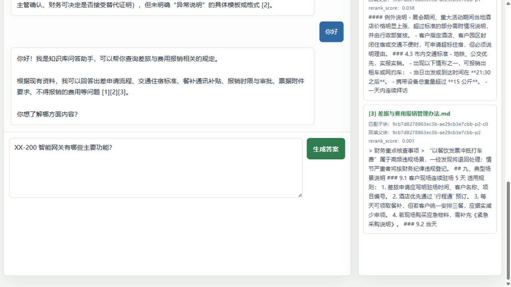
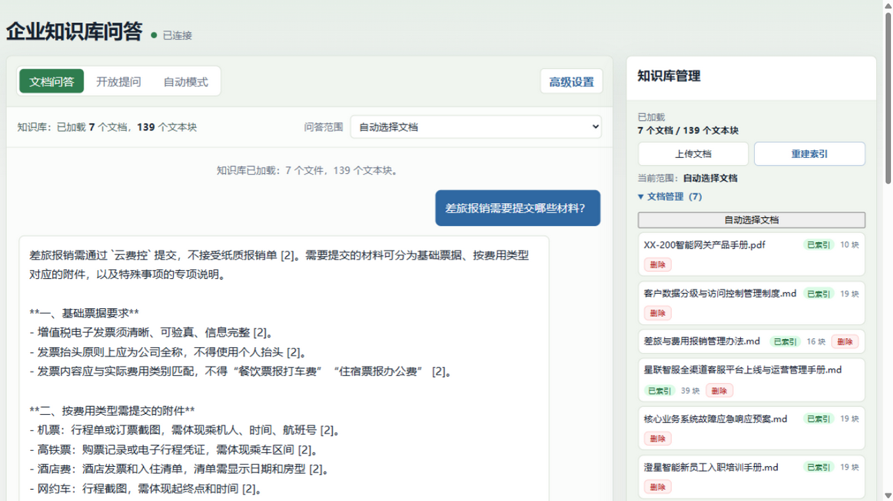

# RAG 知识库系统（LangChain 实现）

基于 LangChain + FastAPI 的企业知识库问答系统：本地知识库检索问答、联网搜索问答、ReAct Agent 自动编排三合一，附带完整的查询路由、混合检索与重排序链路。

存储层已完成 PostgreSQL + pgvector 产品化改造（蓝绿索引、事务一致性、容器化部署），详见 [docs/ARCHITECTURE.md](docs/ARCHITECTURE.md)。

## 演示



*左：SSE 流式回答（带 [编号] 引用标记）；右：知识库管理与引用来源（匹配子块 / 回填父块 / rerank 分数）*



## 架构

```
用户 → FastAPI（限流 / API Key 认证 / 结构化日志 / request_id）
     ├─ 查询路由：规则特征 → 证据校验(阈值实验校准) → LLM 兜底
     ├─ 检索链路：BGE-M3(1024维,ONNX) + BM25(jieba) → RRF(k=60) → CrossEncoder 精排 → 父块展开
     ├─ 生成：DeepSeek（SSE 逐 token 流式）+ 来源编号引用
     └─ 存储：PostgreSQL 16 + pgvector
         ├─ 蓝绿索引：building → 校验 → 原子切换 is_active → retired 保留
         ├─ 三层并发：进程锁 + advisory lock + 任务表（409 冲突语义）
         └─ 心跳恢复：活跃构建不被启动回收误杀
```

## 技术栈

| 层 | 技术 |
| --- | --- |
| 后端 | Python 3.10+ / FastAPI / SQLAlchemy 2.0 / Alembic |
| 存储 | PostgreSQL 16 + pgvector（HNSW）|
| 检索 | BGE-M3（ONNX）/ jieba + BM25 / RRF / bge-reranker-base |
| 前端 | 原生 Vue 3（ES Module，本地 vendor，零 CDN 依赖） |
| 测试 | Pytest（单元 / 集成 / 故障注入 / 迁移） |
| 部署 | Docker Compose（dev / prod 双配置）/ GitHub Actions CI |

## 核心特性

- **父子分块索引**：子块（约 700 字，语义边界切分）用于召回，命中后展开父块（约 1800 字）提供给大模型，兼顾召回精度与上下文完整性
- **混合检索**：BGE-M3 向量检索 + jieba 分词 BM25 关键字检索 → RRF 融合 → `bge-reranker-base` 精排
- **六路查询路由**：规则特征提取 → 证据充分性检查 → LLM 路由兜底，在「知识库 / 联网 / 先库后网 / 直接回答 / 澄清 / 无证据」之间自动决策；文档模式强制走本地库，私有内部问题证据不足时拒绝用公网资料编造
- **ReAct Agent**：LLM 决策 `local_search / web_search / finish`，多步工具调用并输出完整 trace
- **联网搜索**：Tavily 主链路，失败自动重试并 fallback 到 DuckDuckGo
- **会话记忆**：会话级短期记忆（最近 30 轮），支持上下文窗口控制
- **蓝绿索引**：重建写入新版本 → 校验 → 原子切换，永不"先删后建"；失败自动恢复旧版本，retired 版本保留可回滚
- **SSE 流式问答**：逐 token 输出，断连自动落盘部分答案；支持批量上传（逐文件失败隔离）与文档管理（删除/重试）
- **生产加固**：管理端点 API Key 认证、进程内限流（429）、JSON 结构化日志 + request_id、/metrics 可观测端点

## 项目结构

```
backend/
├── main.py            # FastAPI 入口，12 个 REST 端点
├── core/              # 配置加载、LLM 客户端
├── indexing/          # 索引管线：分块、嵌入、pgvector 存储、蓝绿版本、pg_store 适配层
├── knowledge/         # 在线检索门面（子块命中 → 展开父块）
├── services/
│   ├── routing/       # 查询路由子系统（特征/证据/LLM 路由/trace 日志）
│   ├── hybrid_search_service.py   # 向量 + BM25 + RRF
│   ├── rerank_service.py          # 重排序
│   ├── qa_service.py              # 三种回答：知识库/直接 LLM/联网
│   ├── agent_service.py           # ReAct Agent
│   └── memory_store.py            # 会话短期记忆
├── chat/              # 用户模式（文档/自动/开放）→ 执行模式编排
└── tools/             # web_search / weather 工具
frontend/              # 原生 JS 前端（"/" 路径）
web/                   # 独立版前端（"/web" 路径）
legacy/rag.py          # 最早的课程演示脚本
resource data/         # 示例语料（1 份 PDF 产品手册 + 5 份制度文档）
tools/                 # 检索效果测试脚本
```

## 快速开始

```bash
pip install -r requirements.txt

# 配置密钥（参考 .env.example）
cp .env.example .env
# 在 .env 中填入 DEEPSEEK_API_KEY 和 TAVILY_API_KEY

uvicorn api:app --port 8012
# 访问 http://127.0.0.1:8012 （前端）、http://127.0.0.1:8012/docs （API 文档）

# 或使用 Docker Compose（开发配置）
docker compose -f docker-compose.yml -f docker-compose.local.yml up -d --build

# 生产部署（强制密钥变量 / 最小攻击面）
docker compose -f docker-compose.prod.yml up -d --build

# 运维工具
./scripts/deploy-check.sh   # 部署巡检
./scripts/backup-db.sh      # 数据库备份（保留 7 份）
./scripts/restore-db.sh <dump> [目标库]  # 恢复
```

首次启动会自动构建本地索引（需要下载 BGE-M3 ONNX 模型，约 2GB，之后走本地缓存）。

## 主要 API

流式问答：`POST /chat/stream`（SSE，事件流 sources→token→done，前端自动回退非流式）。历史版本清理：`POST /index/prune`（管理端点，保留最近 N 个 retired 版本）。

| 端点 | 说明 |
| --- | --- |
| `POST /chat` | 知识库问答（支持文档/自动/开放三种模式） |
| `POST /agent-chat` | ReAct Agent 自动编排问答 |
| `POST /web-chat` | 联网搜索问答 |
| `POST /search` | 向量检索 |
| `POST /hybrid-search` | 向量 + BM25 + RRF 混合检索 |
| `POST /rerank-search` | 混合检索 + 重排序 |
| `POST /documents/upload` | 上传文档并增量入库 |
| `POST /knowledge-base/rebuild` | 全量重建索引 |
| `POST /memory/clear` | 清空会话记忆 |

## 测试与 CI

```bash
pytest tests/unit -q          # 单元测试（无需外部服务）
pytest tests/integration -q   # 集成测试（需 PostgreSQL：独立 rag_test 库，即建即弃）
ruff check backend tools      # 代码检查
```

GitHub Actions：`backend-ci`（lint / 单元 / pgvector service 集成 / 迁移循环）、`frontend-ci`（语法守卫）、`docker-build`（buildx 构建 + 镜像 smoke）。

## 环境变量

详见 `.env.example` 与 `backend/core/config.py`：`DEEPSEEK_API_KEY`、`TAVILY_API_KEY`、`RAG_EMBEDDING_MODEL`（默认 `BAAI/bge-m3`）、`RAG_RERANK_MODEL`（默认 `BAAI/bge-reranker-base`）及分块、检索、联网搜索等参数。
